<picture>
  <source media="(max-width: 600px)" srcset="assets/hero-mobile.svg">
  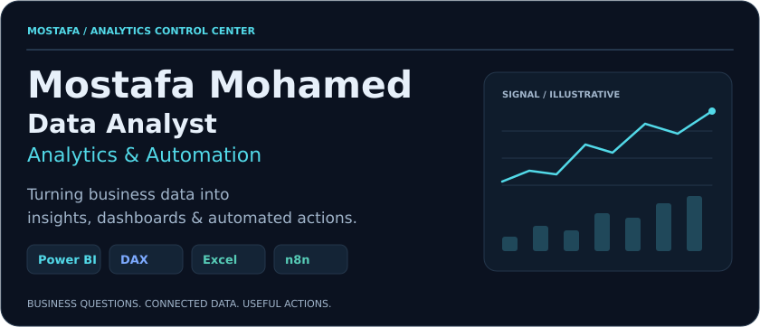
</picture>

  <a href="#project-explorer">Projects</a> ·
  <a href="#system-stack">System Stack</a> ·
  <a href="#automation-lab">Automation Lab</a> ·
  <a href="#connect">Connect</a>

<picture>
  <source media="(max-width: 600px)" srcset="assets/capabilities-mobile.svg">
  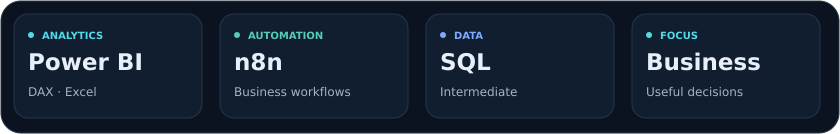
</picture>

I connect analysis with automation: preparing business data, building useful dashboards, and reducing the repetitive work around reporting.

## Project Explorer

<a href="https://mostafamoahmed.netlify.app/">
  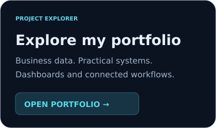
</a>

[View portfolio →](https://mostafamoahmed.netlify.app/)

<!-- Add verified case-study cards here using CASE-STUDY-TEMPLATE.md.
Only publish real project names, descriptions, screenshots, stacks and URLs.
Keep the strongest 4–6 projects. No example projects are presented as completed work. -->

## Data → Business Action

<picture>
  <source media="(max-width: 600px)" srcset="assets/pipeline-mobile.svg">
  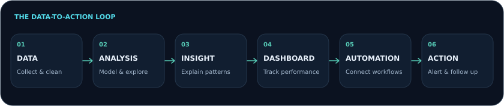
</picture>

**The goal:** make information useful, then automate the next step where it makes business sense.

## System Stack

  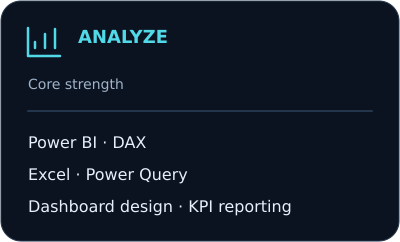
  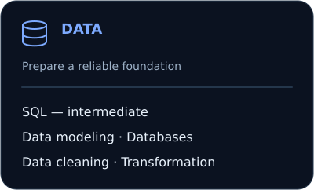
  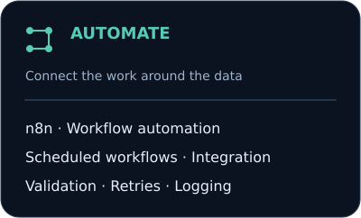
  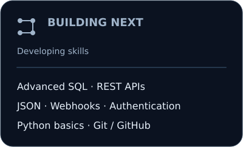

## How I Think About Data

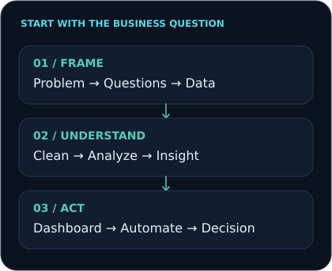

Start with the decision the business needs to make. Work back to the questions, data, and checks needed to support it.

## Automation Lab

**Workflow patterns** I build toward and explore—not a list of completed projects. Each pattern depends on the business rules, data quality, and integration available.

  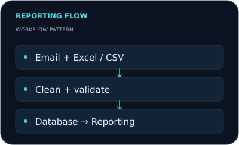
  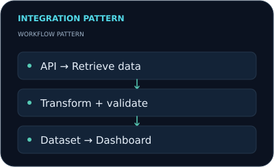
  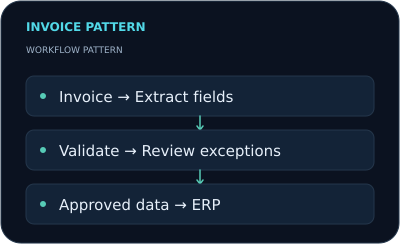
  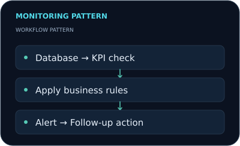

## Learning Radar

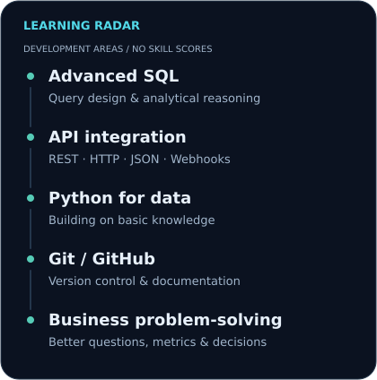

## Connect

[LinkedIn](https://www.linkedin.com/in/mostafa-mohamed-2749b42a4/) · [Portfolio](https://mostafamoahmed.netlify.app/) · [Email](mailto:mostafaelramady516@gmail.com)
