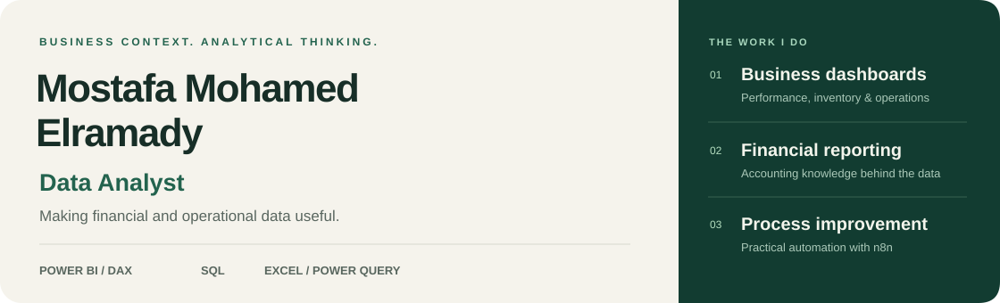

<picture>
  <source media="(max-width: 600px)" srcset="assets/v3/header-mobile.svg">
  
</picture>

### [Explore my portfolio ↗](https://mostafa-mohamed-portfolio-one.vercel.app/)

[LinkedIn](https://www.linkedin.com/in/mostafa-mohamed-2749b42a4/) &nbsp; · &nbsp; [Email](mailto:mostafaelramady516@gmail.com) &nbsp; · &nbsp; [Live invoice workflow](https://mostafaelramady05.github.io/AI-Assisted-Purchase-Invoice-Automation/workflow-viewer.html)

I build **Power BI dashboards and business reports** that make financial and operational performance easier to understand. My accounting work with Saudi companies gives me practical context for the questions behind the numbers.

**Based in Egypt** · Fourth-year **BIS student at Tanta University**, Excellent academic standing · General Accountant since **May 2025**

## Selected client work

Three delivered dashboards across production planning, inventory, and children's hospitality.

<table>
<tr><td>
01 / MANUFACTURING · FORTUNE CAPITAL
<h3>Production &amp; Material Planning</h3>

Connect production plans, bills of materials, and inventory to review <strong>material requirements, shortages, and planned versus actual performance.</strong>

<code>Power BI</code> <code>DAX</code> <code>Power Query</code> <code>Data Modeling</code>

<a href="https://mostafa-mohamed-portfolio-one.vercel.app/projects/manufacturing-mrp-inventory"><strong>Explore the case study ↗</strong></a> &nbsp;·&nbsp; <a href="https://github.com/mostafaelramady05/Supply-Chain-MRP-Analytics">Project repository</a>

</td></tr>
<tr><td>
02 / INVENTORY · FORTUNE CAPITAL
<h3>Inventory Movement &amp; Aging</h3>

Review <strong>stock movement, slow-moving items, aging, availability, and item balances</strong> through connected overview and detail pages.

<code>Power BI</code> <code>DAX</code> <code>Excel</code> <code>Power Query</code>

<a href="https://mostafa-mohamed-portfolio-one.vercel.app/projects/inventory-movement-aging"><strong>Explore the case study ↗</strong></a>

</td></tr>
<tr><td>
03 / HOSPITALITY · JEDDAH, SAUDI ARABIA
<h3>Children’s Hospitality Performance</h3>

Bring <strong>revenue, expenses, profitability, attendance, and customer segments</strong> together for recurring management review.

<code>Power BI</code> <code>Excel</code> <code>Daftra ERP</code> <code>Data Modeling</code>

<a href="https://mostafa-mohamed-portfolio-one.vercel.app/projects/saudi-childcare-performance"><strong>Explore the case study ↗</strong></a>

</td></tr>
</table>

## Capabilities, connected to the work

| What I do | Tools I work with | Where to see it |
| :--- | :--- | :--- |
| **Build performance dashboards** | Power BI · DAX · Data Modeling | Client dashboards above |
| **Prepare and combine business data** | Excel · Power Query · Power Pivot | Production planning and reporting projects |
| **Query and transform data** | SQL · dbt | Part of my analytics toolkit; each project specifies the tools used. |
| **Improve recurring processes** | n8n · APIs · ERP Systems · Daftra | Invoice workflow below |

## Accounting knowledge, applied to process improvement

### [↗ Explore the live invoice workflow](https://mostafaelramady05.github.io/AI-Assisted-Purchase-Invoice-Automation/workflow-viewer.html)

A working system that connects **document upload → extraction → accounting checks → Daftra posting → verification and status tracking**.

I designed the workflow, validation and review paths, ERP integration, and upload/status experience. Open the interactive map to zoom into the workflow, search nodes, and explore its structure.

[**Read the project on GitHub →**](https://github.com/mostafaelramady05/AI-Assisted-Purchase-Invoice-Automation) &nbsp; · &nbsp; [Portfolio case study](https://mostafa-mohamed-portfolio-one.vercel.app/projects/purchase-invoice-automation)

<strong>More analytics projects — personal and learning work</strong>

### Profit & Loss Analyzer

Financial reporting and what-if scenarios built with Power BI and DAX.

[View repository](https://github.com/mostafaelramady05/Profit-and-Loss-Analyzer)

### Wuzzuf Job-Market Analysis

A project connecting collected job listings, data preparation, and Power BI reporting. The scraper GUI was built with AI assistance.

[View repository](https://github.com/mostafaelramady05/Wuzzuf-Jobs-Analysis)

### Logistics & Fleet Management

Operational reporting for freight revenue, fleet costs, and vehicle-level analysis.

[View repository](https://github.com/mostafaelramady05/Fleet-Management)

---

### Have a reporting or data problem to solve?

[**Let’s talk →**](mailto:mostafaelramady516@gmail.com) &nbsp; · &nbsp; [LinkedIn](https://www.linkedin.com/in/mostafa-mohamed-2749b42a4/) &nbsp; · &nbsp; [Portfolio](https://mostafa-mohamed-portfolio-one.vercel.app/)
