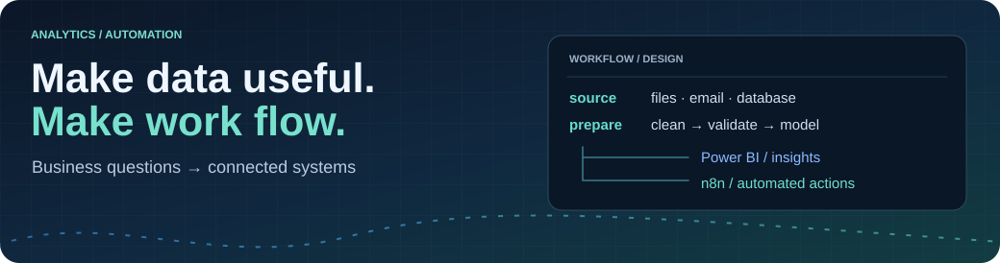
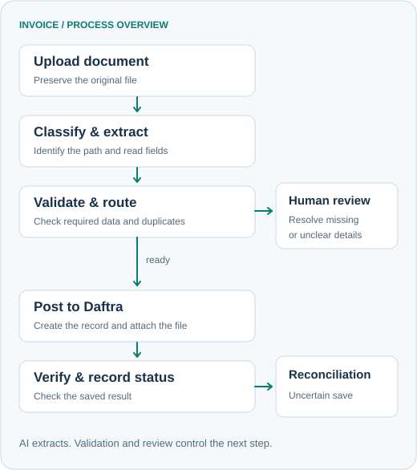
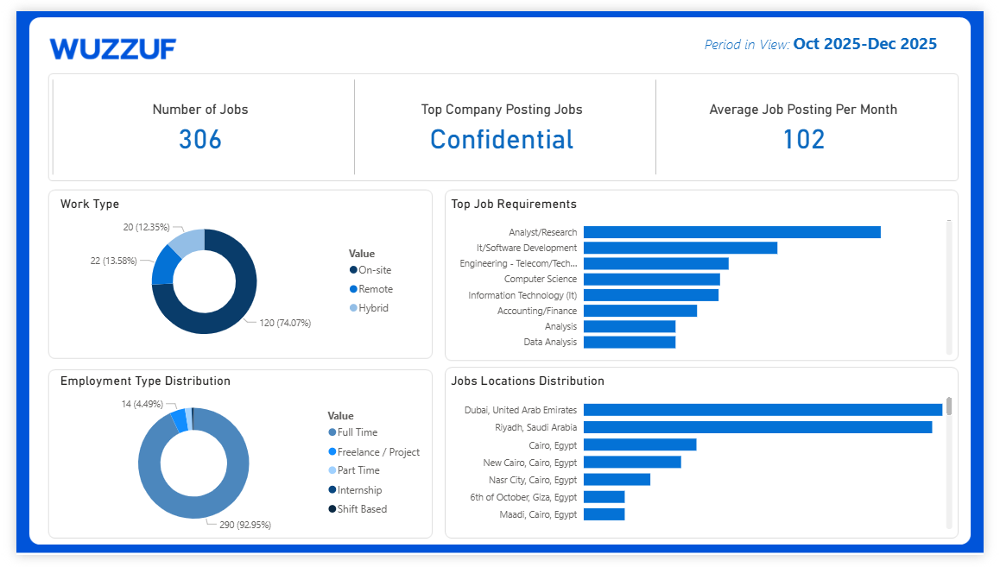
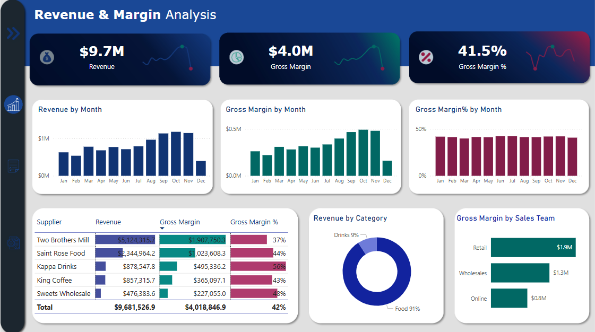
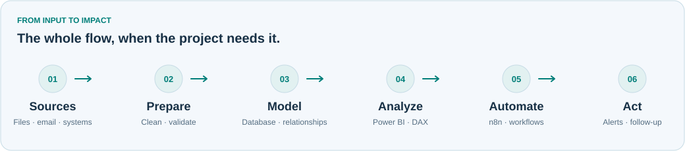

<picture>
  <source media="(max-width: 600px)" srcset="assets/v2/header-mobile.svg">
  
</picture>

# Mostafa Mohamed

### Data Analyst | Analytics & Automation

I turn business data into clear insights, useful dashboards, and automated workflows.

  <a href="https://www.linkedin.com/in/mostafa-mohamed-2749b42a4/">LinkedIn</a> &nbsp;·&nbsp;
  <a href="https://mostafamoahmed.netlify.app/">Portfolio</a> &nbsp;·&nbsp;
  <a href="mailto:mostafaelramady516@gmail.com">Email</a> &nbsp;·&nbsp;
  <a href="https://github.com/mostafaelramady05?tab=repositories">Repositories</a>

POWER BI &nbsp;/&nbsp; DAX &nbsp;/&nbsp; EXCEL &nbsp;/&nbsp; POWER QUERY &nbsp;/&nbsp; n8n

## About my work

I work between **business analytics and process automation**. I clean and model data, build Power BI reports, and connect recurring tasks with n8n and database workflows.

My projects cover production planning, invoice processing, financial reporting, and job-market analysis. I start with the business question, then build the data flow needed to answer it.

## Selected work

<table>
<tr><td>
01 / BUSINESS AUTOMATION
<h3><a href="https://github.com/mostafaelramady05/AI-Assisted-Purchase-Invoice-Automation">AI-Assisted Purchase Invoice Automation</a></h3>

Purchase documents need more than data extraction: missing fields, duplicate records, and uncertain suppliers require checks before posting.

I built an upload-to-status workflow that extracts document data, validates it, routes exceptions for review, posts to Daftra, and verifies the outcome.

<code>n8n</code> <code>AI document extraction</code> <code>Daftra</code> <code>Google Drive</code> <code>Google Sheets</code>

<a href="https://github.com/mostafaelramady05/AI-Assisted-Purchase-Invoice-Automation">Read the case study →</a>

</td></tr>
</table>

<strong>Inside the invoice workflow</strong>

<picture>
  <source media="(prefers-color-scheme: dark)" srcset="assets/v2/invoice-dark.svg">
  
</picture>

Public architecture overview. The production workflow and business data remain private.

<table>
<tr><td>
02 / PRODUCTION & INVENTORY
<h3><a href="https://github.com/mostafaelramady05/Supply-Chain-MRP-Analytics">MRP & Production Tracking</a></h3>

Production plans and raw-material inventory need to be compared at the right level of detail.

A Power BI model connects finished goods, bills of materials, and inventory to calculate material requirements and highlight shortages and plan-versus-actual differences.

<code>Power BI</code> <code>DAX</code> <code>Data Modeling</code> <code>BOM</code>

<a href="https://app.powerbi.com/view?r=eyJrIjoiYjM3ZWNjNjctMjUwYi00NGQzLTk5NjItNzQzODBiNDc0YzNhIiwidCI6IjJiYjZlNWJjLWMxMDktNDdmYi05NDMzLWMxYzZmNGZhMzNmZiIsImMiOjl9">Open dashboard</a> · <a href="https://github.com/mostafaelramady05/Supply-Chain-MRP-Analytics">Repository</a>

</td></tr>
</table>

<table>
<tr>
<td width="50%" valign="top">

<h3>Wuzzuf Job-Market Analysis</h3>

Collected job postings become a refreshable Excel / Power Query dataset and a Power BI view of hiring patterns.

<code>Power BI</code> <code>Power Query</code> <code>Excel</code> <code>Python</code>

Learning project; the scraper GUI was built with AI assistance.

<a href="https://app.powerbi.com/view?r=eyJrIjoiNmRhOWUyYmItMDA1Ni00MDQ3LWFlZGUtYjY4MTExODdkNjEzIiwidCI6IjJiYjZlNWJjLWMxMDktNDdmYi05NDMzLWMxYzZmNGZhMzNmZiIsImMiOjl9&embedImagePlaceholder=true">Dashboard</a> · <a href="https://github.com/mostafaelramady05/Wuzzuf-Jobs-Analysis">Repository</a>

</td>
<td width="50%" valign="top">

<h3>Profit & Loss Analyzer</h3>

Revenue, costs, and operating income brought together with financial comparisons and what-if scenarios.

<code>Power BI</code> <code>DAX</code> <code>Scenario Analysis</code>

<a href="https://github.com/mostafaelramady05/Profit-and-Loss-Analyzer">Explore the project →</a>

</td>
</tr>
</table>

## How the pieces connect

<picture>
  <source media="(max-width: 600px) and (prefers-color-scheme: dark)" srcset="assets/v2/flow-mobile-dark.svg">
  <source media="(max-width: 600px)" srcset="assets/v2/flow-mobile-light.svg">
  <source media="(prefers-color-scheme: dark)" srcset="assets/v2/flow-dark.svg">
  
</picture>

**Start with a business problem.** Define the question, check the data, explain what matters, and automate the repeatable steps where useful.

## Tools I work with

| Area | My working stack |
| :--- | :--- |
| **Analytics & BI** | Power BI · DAX · Excel · Power Query |
| **Data preparation** | Cleaning · Transformation · Data Modeling · KPI Reporting |
| **Automation** | n8n · Scheduled & email-triggered workflows · Database integration |
| **Workflow reliability** | Data validation · Error handling · Retry logic · Logging |
| **Databases** | SQL — intermediate · Relational databases · Data extraction |

<strong>What I’m developing next</strong>

- **Advanced SQL:** stronger queries and analytical problem-solving.
- **Integrations:** REST APIs, HTTP requests, JSON, webhooks, and authentication.
- **Python:** building on basic knowledge for data processing and automation.
- **Git / GitHub:** version control and clearer project documentation.
- **Business analysis:** better questions, metric definitions, and interpretation.

## Let’s connect

Interested in Power BI dashboards, reporting automation, or connecting a repetitive business process? Let’s talk.

[LinkedIn](https://www.linkedin.com/in/mostafa-mohamed-2749b42a4/) &nbsp;·&nbsp; [Portfolio](https://mostafamoahmed.netlify.app/) &nbsp;·&nbsp; [Email](mailto:mostafaelramady516@gmail.com)

