<picture>
  <source media="(max-width: 600px)" srcset="assets/v4/intro-mobile.svg">
  
</picture>

**Business context → Data preparation → Analysis → Practical decisions**

## The person behind the dashboards

- 🎓 Fourth-year **Business Information Systems student at Tanta University**, with an **Excellent** academic standing.
- 📊 **Data Analyst** with three delivered client dashboard projects across manufacturing, inventory, and hospitality.
- 💼 **General Accountant since May 2025**, working remotely from Egypt through an accounting office serving Saudi companies in different industries.
- 🧾 My accounting work includes sales and purchase invoices, tax returns, and zakat returns.
- ⚡ I use **n8n automation to improve accounting and data tasks**, including a working invoice-processing system integrated with Daftra.

## My toolkit, by purpose

### 📊 Analytics & Business Intelligence

### 📑 Excel & Data Preparation

### 🗄️ Data & Transformations

### ⚡ Process Automation & ERP

**How I use these tools:** prepare the data, build the model, define useful KPIs, and make the result easier to act on. Each project below identifies its specific stack.

## Selected work / real business problems

<table>
<tr><td>
01 / PRODUCTION PLANNING · CLIENT WORK
<h3>Can the available materials support the production plan?</h3>

<strong>Production &amp; Material Planning — Fortune Capital</strong> Connected production plans, bills of materials, and inventory to review requirements, shortages, and planned versus actual performance.

<code>Power BI</code> <code>DAX</code> <code>Power Query</code> <code>Data Modeling</code>

<a href="https://mostafa-mohamed-portfolio-one.vercel.app/projects/manufacturing-mrp-inventory"><strong>Explore the case study ↗</strong></a> · <a href="https://github.com/mostafaelramady05/Supply-Chain-MRP-Analytics">Repository</a>

</td></tr>
<tr><td>
02 / INVENTORY · CLIENT WORK
<h3>Which stock is moving — and which needs attention?</h3>

<strong>Inventory Movement &amp; Aging — Fortune Capital</strong> Views of inbound/outbound movement, aging, availability, slow-moving items, and item balances.

<code>Power BI</code> <code>DAX</code> <code>Excel</code> <code>Power Query</code>

<a href="https://mostafa-mohamed-portfolio-one.vercel.app/projects/inventory-movement-aging"><strong>Explore the case study ↗</strong></a>

</td></tr>
<tr><td>
03 / BUSINESS PERFORMANCE · CLIENT WORK
<h3>How do financial results connect to customer activity?</h3>

<strong>Children’s Hospitality Performance — Jeddah</strong> A management dashboard connecting revenue, expenses, profit, attendance, and customer segments.

<code>Power BI</code> <code>Excel</code> <code>Daftra ERP</code>

<a href="https://mostafa-mohamed-portfolio-one.vercel.app/projects/saudi-childcare-performance"><strong>Explore the case study ↗</strong></a>

</td></tr>
</table>

## Beyond dashboards / making the process work

### Purchase Invoice Automation

**Upload → Extract → Validate → Record in Daftra → Verify & track**

I designed the document routing, accounting checks, review paths, ERP integration, and upload/status experience. The workflow handles purchase invoices, simplified tax invoices, and supplier payment receipts.

### [🔎 Explore the live n8n workflow](https://mostafaelramady05.github.io/AI-Assisted-Purchase-Invoice-Automation/workflow-viewer.html)

**Zoom · Search nodes · Explore connected accounting paths**

[View the project on GitHub](https://github.com/mostafaelramady05/AI-Assisted-Purchase-Invoice-Automation) · [Read the portfolio case study](https://mostafa-mohamed-portfolio-one.vercel.app/projects/purchase-invoice-automation)

## The project shelf

<strong>Explore personal and learning projects</strong>

| Project | Focus | Repository |
| :--- | :--- | :--- |
| **Profit & Loss Analyzer** | Financial reporting, DAX, and what-if scenarios | [Explore ↗](https://github.com/mostafaelramady05/Profit-and-Loss-Analyzer) |
| **Wuzzuf Job-Market Analysis** | Job data collection, preparation, and Power BI reporting | [Explore ↗](https://github.com/mostafaelramady05/Wuzzuf-Jobs-Analysis) |
| **Logistics & Fleet Management** | Freight revenue, fleet costs, and operational reporting | [Explore ↗](https://github.com/mostafaelramady05/Fleet-Management) |

The Wuzzuf scraper GUI was built with AI assistance. These projects are personal/learning work; client work is identified separately above.

## Let’s build something useful

Have a dashboard, reporting, or data problem to work through? Let’s talk.

**Clear data. Useful insight. Practical improvements.**

